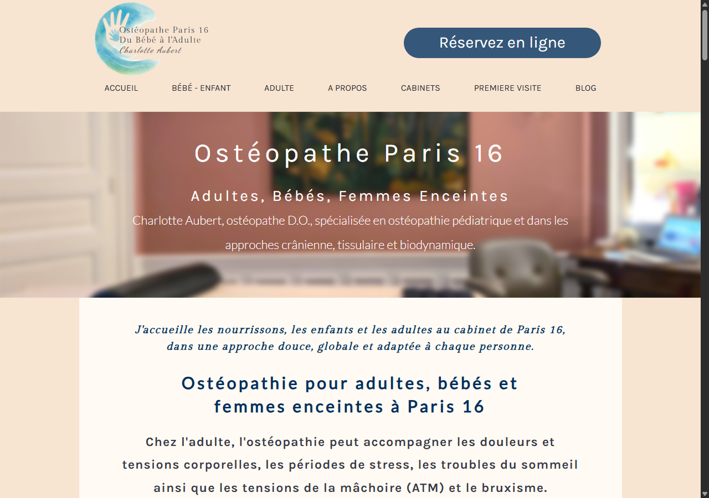

# Site Aubert Ostéopathe

Reproduction locale de la page d’accueil de [Charlotte Aubert, ostéopathe à Paris 16](https://www.aubert-osteopatheparis16.com/), réalisée avec Next.js.

## Aperçu



*Capture de la page d’accueil à 1280 × 900 px.*

## Contenu du site

Le parcours d’accueil réunit les sections suivantes :

1. En-tête fixe avec identité du cabinet, navigation déroulante et réservation en ligne.
2. Bannière d’accueil et présentation du cabinet.
3. Présentations des soins pédiatriques, adultes et femmes.
4. Cartes des expertises en ostéopathie.
5. Présentation de l’approche et biographie de Charlotte Aubert.
6. Sélection d’articles de blog, appel à la réservation et pied de page avec réseaux sociaux et formulaire de contact.

La navigation par section reste sur la page d’accueil (`/`). La réservation pointe vers Doctolib; les pages de détail et les articles qui ne sont pas clonés restent des liens vers le site d’origine. Le formulaire est uniquement visuel et indique clairement que l’envoi de messages n’est pas connecté.

## Architecture

```text
src/
├── app/
│   ├── page.tsx                 # Sections, navigation, cartes et liens de la page d’accueil
│   ├── layout.tsx               # Layout global, polices locales Next.js et métadonnées
│   ├── globals.css              # Styles et mise en page de la reproduction
│   └── favicon.ico
└── components/
    └── sites/aubert/
        └── contact-form.tsx     # Formulaire avec validation et message d’information

public/
└── sites/aubert-osteopatheparis16/
    ├── homepage-preview.png     # Capture d’écran présentée ci-dessus
    └── ...                      # Logo, photos, cartes, articles et icônes sociales

docs/
└── research/aubert-osteopatheparis16/
    └── page-brief.md            # Sections, mesures, interactions et correspondance des ressources
```

Le projet utilise Next.js 16 App Router, React 19, TypeScript et Tailwind CSS v4. Les polices de la page sont chargées via `next/font/google`.

## Installation et lancement

Prérequis : Node.js 24 ou supérieur.

```powershell
npm.cmd install
npm.cmd run dev
```

Ouvrir ensuite [http://localhost:3000](http://localhost:3000). Arrêter le serveur avec `Ctrl+C` dans le terminal.

## Vérifications

```powershell
npm.cmd run lint
npm.cmd run typecheck
npm.cmd run build
npm.cmd run check
```

## Fidélité et limites connues

- À 390 px, la version d’origine déborde horizontalement au lieu de réorganiser la mise en page mobile; cette reproduction conserve ce comportement.
- Seule la page d’accueil est clonée. Les pages de détail et les articles restent externes.
- Le formulaire ne transmet ni ne stocke les données saisies.
